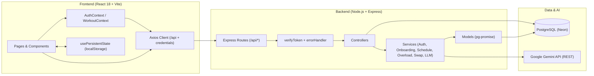
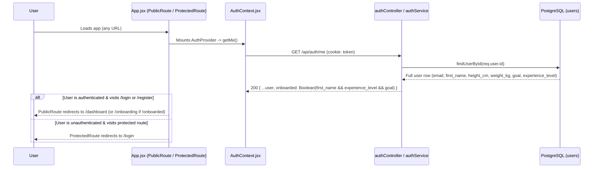
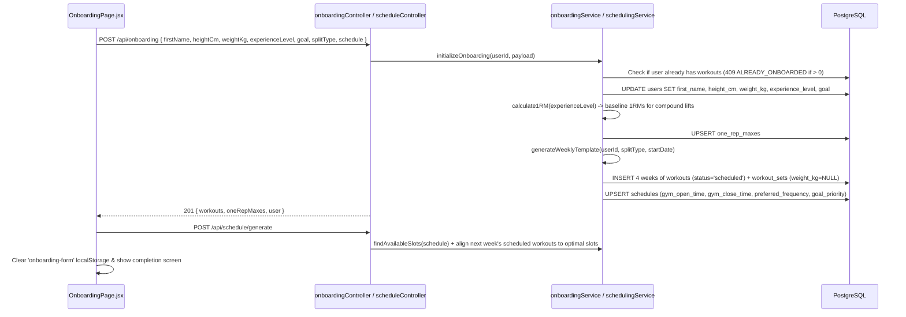
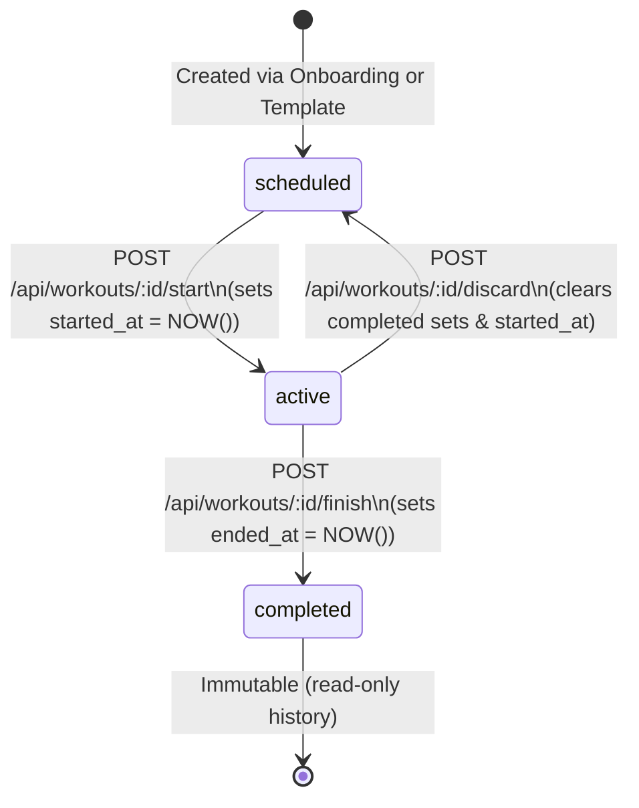
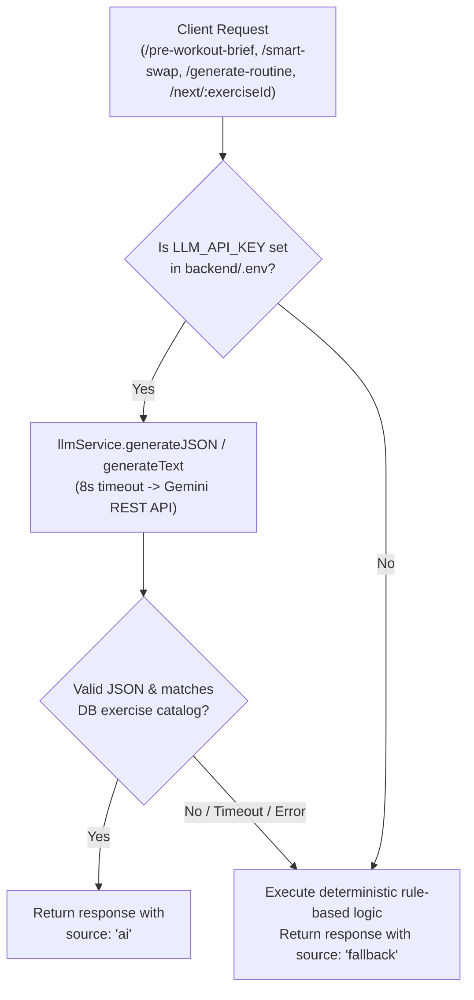

# Smart Lifting Optimizer — Code Flow & System Architecture

This document traces the end-to-end execution flow of the Smart Lifting Optimizer across the React 18 frontend, the Express/Node.js backend, the PostgreSQL database, and the Google Gemini LLM integration.

---

## 1. High-Level Architecture

### Core Architectural Layers
1. **Transport & Session Layer:**
   - The Vite dev server proxies `/api/*` requests from `http://localhost:5173` to `http://localhost:3001`.
   - `frontend/src/api/client.js` configures Axios with `baseURL: '/api'` and `withCredentials: true` so the browser automatically sends and receives the `httpOnly` JWT cookie (`token`).
2. **Authentication & Error Middleware:**
   - `backend/src/middleware/verifyToken.js` extracts the JWT from either `req.cookies.token` or `Authorization: Bearer <token>`, verifies it with `JWT_SECRET`, and attaches `{ id, iat, exp }` to `req.user`.
   - `backend/src/middleware/errorHandler.js` catches any thrown `err` and returns `{ error: err.message, ...(err.code && { code: err.code }), ...(err.field && { field: err.field }) }` with `err.status || 500`.
3. **Resilient AI Layer:**
   - `backend/src/services/llmService.js` wraps Google Gemini's `generateContent` REST endpoint with an `8000ms` `AbortController` timeout and strict JSON parsing.
   - Every AI-powered feature (`pre-workout-brief`, `smart-swap`, `generate-routine`, `calculateNextSession`) wraps the LLM call in a `try/catch` and falls back to deterministic biomechanical/mathematical rules if `LLM_API_KEY` is unset, invalid, or times out.

---

## 2. Authentication, Session Restoration & Route Guard Flow

### Key Implementation Details
- **Registration (`POST /api/auth/register`):**
  1. `RegisterPage.jsx` validates email format, password rules (`>= 8` chars, `>= 1` letter, `>= 1` number), and password confirmation live in the UI.
  2. `authService.register({ email, password })` normalizes the email (`trim().toLowerCase()`), checks for existing accounts (`409 EMAIL_TAKEN`), hashes the password with `bcryptjs` (`salt = 12`), inserts the user into `users`, and signs a 7-day JWT.
  3. `authController.register` sets the `httpOnly` cookie and returns `{ user: { ...user, onboarded: false }, token }`.
  4. Frontend navigates directly to `/onboarding`.
- **Login (`POST /api/auth/login`):**
  1. `authService.login({ email, password })` queries `users` by lowercased email.
  2. If no user exists, throws `404 USER_NOT_FOUND` (`field: 'email'`, naming the email address).
  3. If the bcrypt comparison fails, throws `401 WRONG_PASSWORD` (`field: 'password'`).
  4. `LoginPage.jsx` reads `err.response?.data?.field` and attaches the error message directly below the offending input.

---

## 3. Onboarding, 1RM Estimation & 4-Week Program Seeding Flow

### Why `weight_kg` Is Seeded as `NULL`
When `onboardingService.generateWeeklyTemplate` creates the initial `workout_sets` rows for the 4-week program, `weight_kg` is intentionally inserted as `NULL` (not `0`). In `WorkoutPage.jsx`, `hasValue(v)` treats `null`, `''`, and `0` as empty so that new sets show the previous-performance or target ghost placeholder instead of pre-filling `0` into the input box.

---

## 4. Workout Lifecycle & In-Workout Logger Flow

A workout moves through a strict state machine enforced by both the backend (`workoutController.js`) and a PostgreSQL partial unique index (`uq_one_active_workout_per_user`).

### Step-by-Step In-Workout Execution (`WorkoutPage.jsx`)
1. **Loading & Grouping (`GET /api/workouts/:id`):**
   - `workoutController.getWorkout` fetches:
     - `workout` metadata + all `sets` ordered by `(set_type = 'working'), set_number ASC`.
     - `notes_by_exercise` from `workout_logs`.
     - `previous`: for every `exercise_id` in the workout, fetches the sets from the user's most recent **completed** workout containing that exercise (`workoutSetModel.getPreviousSessionSets`).
   - On the frontend, `groupExercises(workout.sets)` groups flat set rows by `exercise_id` while preserving exercise order.
2. **Pre-Fill & Ghost Text Resolution (`valuesFor` & `placeholdersFor`):**
   - For each set row, `WorkoutPage.jsx` checks:
     1. `draft.inputs[set.id]` (unsaved numbers typed by the user in `localStorage`).
     2. If the set is already `completed`, uses its saved `set.weight_kg` and `set.reps`.
     3. Otherwise, pre-fills `weight` from `set.weight_kg` (if a template default weight was set) or `previous.weight_kg` (from the last completed session), and `reps` from `previous.reps ?? set.reps`.
   - The `Previous` column displays `${previous.weight_kg} kg × ${previous.reps}` (or `—` if never performed before).
3. **Starting the Workout (`POST /api/workouts/:id/start`):**
   - While `status === 'scheduled'`, the user is in **Planning Mode**: they can add/remove/swap exercises, add sets, or type planned weights/reps, but the completion checkboxes show a Lock icon (`canLog = false`).
   - Clicking **Start Now** calls `POST /api/workouts/:id/start`.
   - The backend checks if another workout is already `active` for this user. If so, it returns `409 ANOTHER_WORKOUT_ACTIVE` with `active_workout_id` so the UI can link directly to it. Otherwise, it sets `status = 'active'` and `started_at = COALESCE(started_at, NOW())`.
4. **Logging & Locking Sets (`PUT /api/workouts/:id/sets/:setId`):**
   - When the user ticks a set's checkbox (`handleToggle`):
     - The frontend validates that `reps > 0`.
     - Optimistically updates `workout.sets` and starts the countdown `RestTimer` (`120s` for working sets, `60s` for warm-up sets) inside `draft.rest` (`endsAt = Date.now() + durationMs`).
     - Sends `PUT /api/workouts/:id/sets/:setId` with `{ weight_kg, reps, completed: true }`.
     - Once `completed === true`, both the frontend (`SetRow.jsx`) and backend (`workoutController.updateSet`) **lock** the set against accidental edits (`409 SET_LOCKED`) until the user un-ticks the checkbox (`completed: false`).
5. **Navigating Away While Active (`InProgressCard` on Dashboard):**
   - If the user clicks the Back button while `status === 'active'`, `ConfirmDialog` offers:
     - **Leave screen (keep workout running):** navigates to `/dashboard`, where `DashboardPage.jsx` detects `workouts.find(w => w.status === 'active')` and replaces the "Next Session" card with `InProgressCard` (displaying live elapsed time, progress bar, next set, synchronized rest timer from `localStorage`, **Go to workout**, and **Finish workout**).
     - **Finish workout:** completes the session (`POST /api/workouts/:id/finish`).
     - **Stop & discard workout:** calls `POST /api/workouts/:id/discard`, which resets all sets in that workout to `completed = false, completed_at = NULL` and reverts the workout to `status = 'scheduled', started_at = NULL`.

---

## 5. AI Integration & Fallback Flow

1. **Pre-Workout Brief (`POST /api/ai/pre-workout-brief`):**
   - Fetches the last 3 completed sessions for each exercise in the workout.
   - Prompts Gemini for a 2-sentence actionable coaching cue.
   - Fallback: summarizes the most recently trained exercise's top weight × reps and suggests adding `2.5 kg` or `+1 rep`.
   - Cached in `localStorage` under `brief-${workoutId}` so refreshing the workout page does not re-trigger LLM calls.
2. **Smart Swap (`POST /api/ai/smart-swap`):**
   - Accepts `{ exercise_id, reason }`.
   - Queries all exercises in the same `muscle_group`.
   - Prompts Gemini to pick 2 biomechanically equivalent alternatives that respect the user's `reason` (e.g., `"lower back pain"` or `"barbell rack taken"`), validating returned IDs against the DB catalog.
   - Fallback: `swapService.findAlternatives` scores same-muscle exercises by equipment simplicity and compound/isolation match, avoiding equipment mentioned in `reason`.
3. **Routine Generator (`POST /api/ai/generate-routine`):**
   - Accepts `{ prompt }` (e.g., `"I only have dumbbells and 45 minutes"`).
   - Passes the full DB exercise catalog (`id, name, muscle_group, equipment_needed`) to Gemini and requests a structured JSON split (`{ name, exercises: [{ exercise_id, sets, rep_min, rep_max }] }`).
   - Fallback: parses keywords from the prompt (`push`, `pull`, `leg`, `upper`, `lower`, equipment filters like `dumbbell`/`bodyweight`, and minute durations) to assemble a balanced 4–6 exercise template from the catalog.
4. **Progressive Overload Suggestion (`GET /api/workouts/next/:exerciseId`):**
   - `progressiveOverloadService.calculateNextSession` computes a deterministic baseline from the last 3 sessions (if all sets completed and average reps >= target, increments weight by `2.5%` rounded to `0.5 kg` or adds `1 rep`; if no history, uses `60%` of estimated 1RM × `8 reps`).
   - Optionally refines the suggestion via Gemini within a safe `±10%` clamp of the deterministic weight.

---

## 6. Analytics & Muscle Recovery Calculation Flow

1. **Dashboard Summary (`GET /api/analytics/summary`):**
   - Computes current ISO week (`date_trunc('week', NOW())`) planned vs. completed workouts, working sets completed, and total working volume (`SUM(weight_kg * reps)`).
   - Generates an 8-week Monday-aligned volume series (`weekly_volume`) and a 7-day Mon–Sun heatmap (`level` `0..4` normalized against the week's peak day). New accounts with zero completed sets receive all zeros.
2. **Rolling 7-Day Muscle Recovery (`GET /api/analytics/recovery`):**
   - Queries all completed **working** sets from the last 7 days joined with `exercises.muscle_group`.
   - Applies an exponential recency decay per set:
     $$\text{weighted\_sets} = \sum \exp\left(-\frac{\text{age\_days}}{4}\right)$$
   - Normalizes `fatigue` to `0–100` where `10` recent working sets = `100%` fatigue.
   - `MuscleBodyMap.jsx` colors each SVG muscle group using `--success` (`< 35%` Recovered), `--warning` (`35–69%` Moderate), and `--danger` (`>= 70%` High fatigue).
3. **Profile Lifetime Stats (`GET /api/analytics/profile-stats`):**
   - Aggregates lifetime completed workouts, working sets, total volume, average workout duration (`EXTRACT(EPOCH FROM (ended_at - started_at)) / 60`, clamped to `1..300` min), top 3 heaviest lifts, most-trained muscle group, and consecutive active ISO week streak (`streak_weeks`).
