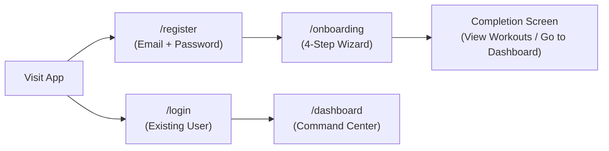
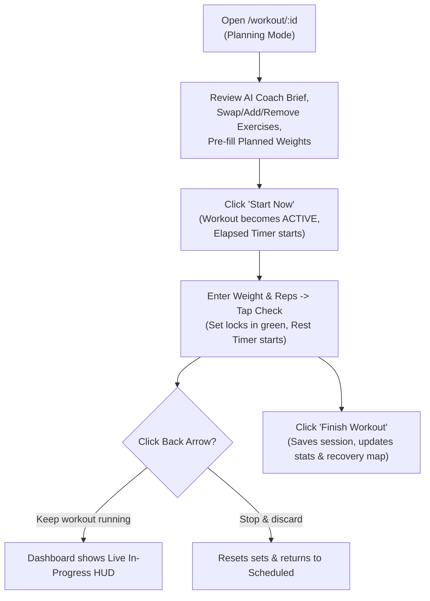

# Smart Lifting Optimizer — User Workflow Guide

This document describes the complete user journey through the Smart Lifting Optimizer, explaining how every screen works, what actions a user can take, and how to verify each feature step by step.

---

## Pre-Flight Checklist

1. **Start Backend:**
   ```bash
   cd backend && npm run dev
   ```
   Confirm `http://localhost:3001/api/health` returns `{"status":"ok"}`.
2. **Start Frontend:**
   ```bash
   cd frontend && npm run dev
   ```
   Open `http://localhost:5173`.

---

## 1. Account Creation & Sign-In (`/register` & `/login`)



### 1.1 Creating a New Account (`/register`)
1. Navigate to `/register`.
2. Enter your **Email**, **Password**, and **Confirm Password** (First Name is collected in Step 1 of Onboarding).
3. Watch the live password checklist turn green as each requirement is met:
   - At least **8 characters**
   - At least **1 letter**
   - At least **1 number**
4. Click **Create Account** → you are automatically signed in and directed to `/onboarding`.
5. **Error Handling:**
   - Registering an existing email highlights the email field and provides a direct **Sign in instead** link.

### 1.2 Signing In (`/login`)
1. Enter your registered **Email** and **Password** (use the eye icon to toggle password visibility).
2. **Field-Specific Feedback:**
   - Unknown email → inline error under Email: *"No account found for {email}. Check the spelling or create an account."*
   - Wrong password → inline error under Password: *"Incorrect password. Please try again."*
3. **Public Route Protection:** Once signed in, visiting `/login` or `/register` (or pressing the browser Back button) automatically redirects you to `/dashboard`.

---

## 2. 4-Step Onboarding Wizard (`/onboarding`)

Your answers are automatically saved to `localStorage` (`onboarding-form`) as you progress, so refreshing the browser never loses your place.

1. **Step 1 — About You:**
   - Enter your **First Name** (required), **Height (cm)** (`100–250`), **Weight (kg)** (`30–400`), and select your **Experience Level** (`Beginner`, `Intermediate`, or `Advanced`).
   - Your experience level seeds baseline 1-Rep Max (1RM) estimates for compound lifts.
2. **Step 2 — Training Goal:**
   - Choose your primary goal: **Strength**, **Hypertrophy**, **Weight Loss**, or **Endurance**.
3. **Step 3 — Workout Split:**
   - Choose your preferred structure:
     - **Push / Pull / Legs (PPL)** — 4 sessions/week
     - **Upper / Lower** — 4 sessions/week
     - **Full Body** — 3 sessions/week
4. **Step 4 — Availability & Gym Hours:**
   - Answer **"Do you train at the same gym every day?"**:
     - **Yes, same gym:** reveals **Gym opens** and **Gym closes** time pickers (`TimeInput`). You can type hours/minutes directly (`00–23` : `00–59`, arrow keys increment/decrement) or click the dropdown button to pick from non-looping scrollable lists.
     - **No, I train at different places:** skips fixed gym hours and schedules sessions using default daytime windows.
   - Select **Preferred Time** (`Morning` or `Evening`) and adjust the **Weekly Frequency** slider (`1` to `7` days).
   - Click **Finish Setup ✓**.
5. **Completion Screen:**
   - Displays *"You're all set, {FirstName}!"* with the total number of generated workouts (4-week program).
   - Choose **View my workouts** (`/workouts`) or **Go to dashboard** (`/dashboard`).

---

## 3. Navigation & Theme Switching (Persistent Sidebar)

Every main page (`/dashboard`, `/workouts`, `/templates`, `/profile`) shares a single persistent sidebar (`AppLayout.jsx`) on desktop and a bottom navigation bar on mobile:
- **Navigation Links:** Dashboard, Workouts, Templates, Profile.
- **User Badge:** Displays your initial, first name, and real email address.
- **Light / Dark Theme Toggle:** Click **Light mode** / **Dark mode** at the bottom of the sidebar to switch between **Midnight Slate** (Dark `#15181D`) and **Warm Porcelain** (Light `#F4F2EE`). Your choice persists in `localStorage` (`smartlift-theme`).

---

## 4. Command Center Dashboard (`/dashboard`)

### 4.1 Top Hero Card (Two Modes)
- **Mode A — Next Session Card (No workout currently active):**
  - Displays your next upcoming scheduled workout with its human-readable split or custom template name, scheduled date/time, and a live countdown timer (`Days : Hrs : Min : Sec`).
  - Click **Start Workout** to open the workout in `/workout/:id`.
- **Mode B — Workout In Progress HUD (When a workout is currently `active`):**
  - Automatically replaces the Next Session card whenever a workout is running.
  - Shows a live elapsed timer (`MM:SS`), a thin champagne progress line, **Up next** (next incomplete exercise and set number), **Rest** (live countdown synced with the workout logger), **Go to workout**, and **Finish workout**.

### 4.2 Analytics Widgets
- **Weekly Stats:** Shows `Workouts (completed / planned)`, `Sets Completed`, and `Volume (kg)` for the current Monday–Sunday week (starts at `0` for new accounts).
- **Volume Progress (8-Week Area Chart):** Tracks weekly lifting volume over the last 8 weeks.
- **Weekly Heatmap:** 7-day (`Mon–Sun`) tonal intensity grid showing which days of the current week you trained and total volume per day on hover.
- **Monthly Volume (30-Day Bar Chart):** Summarizes 30-day total volume and working sets across the last 5 weeks.
- **Muscle Recovery Body Map:** Interactive Front + Back SVG anatomy diagram colored by rolling 7-day working-set fatigue:
  - **Recovered (`< 35%`):** Sage Green (`--success`)
  - **Moderate (`35–69%`):** Warm Ochre (`--warning`)
  - **High Fatigue (`>= 70%`):** Muted Rose (`--danger`)
  - Hover or focus any muscle group to inspect its exact status and 7-day working set count.
- **Sync to Calendar:** Click **Sync to Calendar** in the top-right header to download `workouts.ics` containing all upcoming scheduled workouts (with 1-hour duration and 30-minute reminders) for Google Calendar, Apple Calendar, or Outlook.

---

## 5. In-Workout Logger & Session Lifecycle (`/workout/:id`)



### 5.1 Planning Mode vs. Active Mode
1. Opening a `scheduled` workout starts in **Planning Mode**:
   - A banner at the top reads: *"You're planning this session — Adjust exercises and numbers now. Press Start Now when you're at the gym to start the clock and log sets."*
   - Set checkboxes display a **Lock icon** so you cannot accidentally mark sets done while previewing.
2. Click **Start Now**:
   - The workout transitions to `active`, the live elapsed timer starts in the sticky header, and all set checkboxes unlock.
   - Only **one** workout can be `active` at a time. If you try to start a second workout while one is already running, an alert banner provides a one-click **Go to it** link.

### 5.2 AI Coach Brief & Progressive Overload Chip
- **AI Coach Brief:** At the top of the workout, the **AI Coach** card (styled in `--ai-tint` with `--ai` accents) gives a 2-sentence personalized briefing based on your last 3 sessions.
- **Overload Chip:** Below each exercise header, a chip shows `Suggested: 80kg × 8` (hover to see the progression rationale).

### 5.3 Logging Sets & Input Ergonomics
Each set row displays: **Set # (or `W` for warm-up)** · **Previous** · **kg** · **Reps** · **Checkbox**:
- **Previous Performance & Pre-fill:** If you have completed this exercise in a past workout, the `Previous` column shows `80 kg × 8` and the inputs pre-fill with your last session's numbers. For brand-new exercises, inputs stay empty so the ghost placeholder is visible.
- **Select-on-Focus:** Clicking or tabbing into any `kg` or `Reps` input automatically selects the entire value so typing immediately replaces it.
- **Completing & Locking a Set:** Tap the checkbox to mark a set complete. The row highlights in green and **locks the `kg` and `Reps` inputs** so you cannot accidentally alter a logged set while scrolling. To edit a completed set, tap the checkbox again to un-tick it.
- **Adding Warm-up & Working Sets:** Click **+ Set** to append a working set, or **🔥 Warm-up** to add a warm-up set (`W`, listed first and excluded from working volume/fatigue calculations).

### 5.4 Automatic Rest Timer
- Completing a working set automatically opens a countdown bar (`2:00` for working sets, `1:00` for warm-ups) directly beneath that set row.
- Use **−** / **+** to adjust by 15 seconds, or **⏭** to skip rest early.
- Because the timer stores an absolute `endsAt` timestamp in `localStorage`, refreshing the browser or switching to the Dashboard keeps the countdown accurate to the second.

### 5.5 Per-Exercise Form Notes (Auto-Save)
- Click **Notes** under any exercise header to expand the notes area.
- Type mobility cues or equipment settings (e.g., *"Seat height 4, left shoulder felt great"*).
- Notes **auto-save** 800ms after you stop typing (`Saving…` → `Saved`), and a green dot indicator appears next to `Notes` when collapsed.

### 5.6 Swapping, Adding & Removing Exercises Mid-Workout
- **Swap Exercise (`⇄` icon):** Opens the Swap Modal with two tabs:
  1. **Smart swap (AI):** Enter an optional constraint (e.g., `"lower back pain"` or `"rack is taken"`) and click **Find** to get 2 biomechanically equivalent alternatives with explanations.
  2. **Choose manually:** Search and filter the full 60+ exercise catalog by muscle group.
  - Selecting an alternative immediately replaces uncompleted sets of that exercise in-place.
- **Remove Exercise (Trash icon):** Opens a custom confirmation dialog to remove the exercise from the workout.
- **+ Add exercise button (bottom of workout):** Opens the searchable Exercise Catalog modal to add a new exercise (3 sets × 10 reps) to the current session.

### 5.7 Leaving, Discarding, or Finishing a Workout
- **Back Arrow while Active:** Opens a custom dialog with 4 choices:
  1. *Leave screen (keep workout running)* → returns to Dashboard with the live `InProgressCard`
  2. *Finish workout*
  3. *Stop & discard workout* → clears logged sets and resets workout to `scheduled`
  4. *Cancel*
- **Finish Workout:** If any sets are still unchecked, a confirmation dialog asks if you want to finish anyway. Confirming marks the workout `completed`, displays the celebration overlay with total sets, volume, and duration, and redirects to the Dashboard.

---

## 6. Workouts Schedule (`/workouts`) & Profile History (`/profile`)

### 6.1 Upcoming Workouts (`/workouts`)
- Displays only **In Progress** and **Scheduled** workouts grouped by week so your upcoming plan stays uncluttered.
- Completed workouts move automatically to your Profile history (linked at the bottom of `/workouts`).

### 6.2 Profile, Edit Details & Completed History (`/profile`)
- **Profile Header & Edit Modal:** Click **Edit profile** to update your First Name, Height, Weight, Training Goal, or Experience Level at any time.
- **Lifetime Training Stats:** Displays **Workouts done**, **Total volume (kg)**, **Avg. duration (min)**, **Week streak**, **Heaviest lifts**, and **Most trained muscle group**.
- **Completed Workouts (Collapsible History):** Click **Completed workouts (N)** at the bottom of `/profile` to expand your past sessions with date, completed sets, total volume, and duration. Clicking any past session opens it in read-only review mode.

---

## 7. Custom Template Builder & AI Routine Generator (`/templates`)

1. **AI Routine Generator Bar:**
   - Enter a natural-language prompt in the top AI Builder bar (e.g., `"I only have dumbbells and 45 minutes for upper body"`) and click **Generate with AI**.
   - The builder populates with a complete split name and matching exercises from the database.
2. **Manual Catalog Picker & Builder:**
   - Search or filter the **Exercise Catalog** on the left by muscle group (`all`, `chest`, `back`, `shoulders`, `biceps`, `triceps`, `legs`, `glutes`, `core`) and click any exercise to add it to your split.
   - For each exercise in your template, configure:
     - **Sets** (`1–10`)
     - **Kg (opt)** — optional default starting weight in kg
     - **Reps** (`min–max` target range, e.g., `8–12`)
   - **Smooth Reordering:** Drag the grip handle (`⠿`) or click the **▲ / ▼** buttons—exercises smoothly glide into their new order via FLIP animation.
   - Click **Save Template** (or **Update Template** when editing an existing one).
3. **Using Saved Templates:**
   - Under **Your Templates**, each card lists its exercises, sets × rep ranges, and any `@ Xkg` default weights.
   - Click **Start workout** (`▶`) to instantiate a new scheduled workout with that template's custom name and default weights and open it immediately in `/workout/:id`.
   - Click the **Pencil** icon to load a template back into the builder for editing, or the **Trash** icon to delete it via the custom confirmation dialog.
